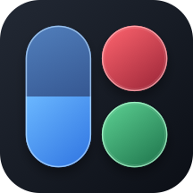
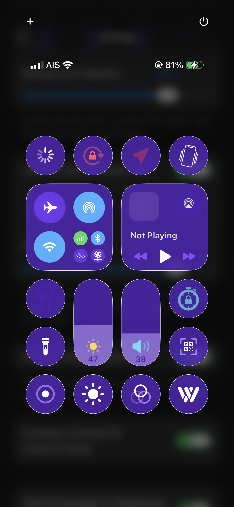
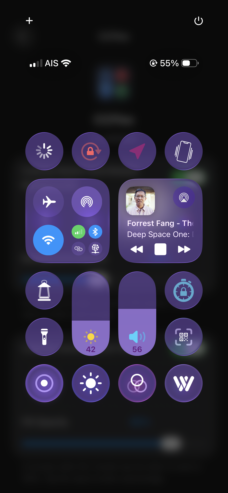
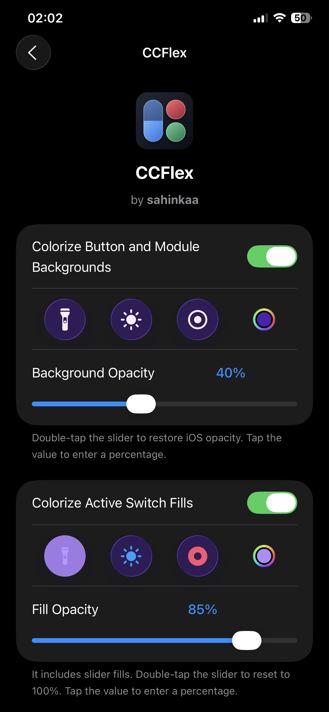
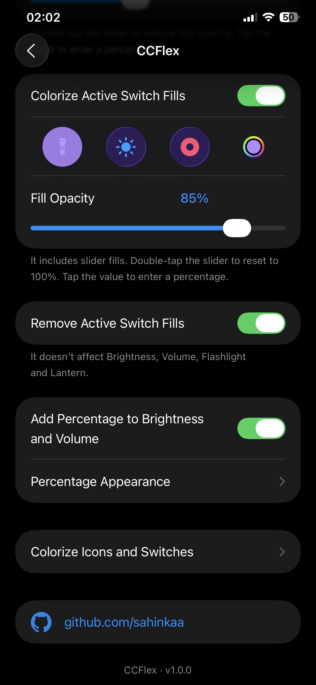
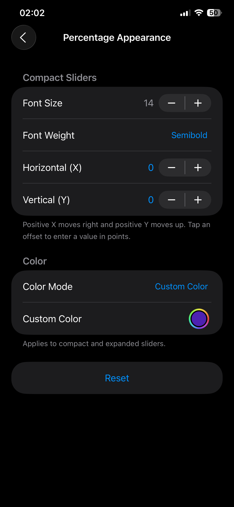
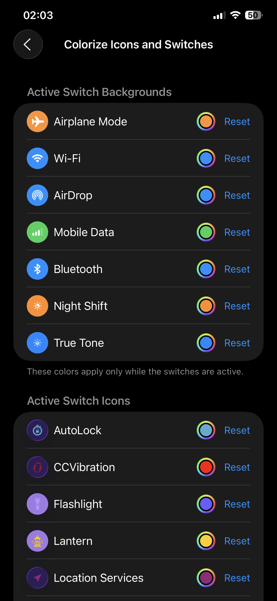
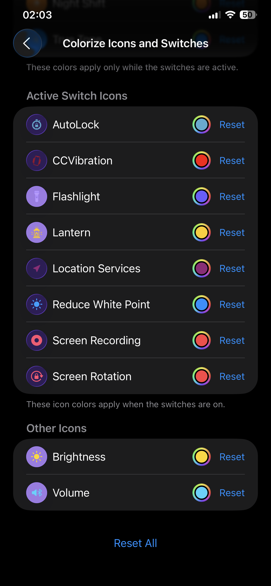

  

# CCFlex

Customize Control Center on jailbroken iOS 26.

- Enable iOS’s native Increase Contrast appearance in Control Center only.
- Tint Liquid Glass buttons, modules and supported long-press menus with adjustable opacity.
- Recolor active switch and slider fills, adjust their opacity or remove supported white switch fills.
- Set individual colors for supported switch backgrounds and icons, including the brightness and volume icons.
- Show brightness and volume percentages in compact and expanded sliders. Adjust the size, weight and position of compact numbers and use adaptive contrast or a custom color in both views.

## Downloads

[RootHide .deb](https://github.com/sahinkaa/CCFlex/releases/download/v1.0.1/com.sahinkaa.ccflex_1.0.1_iphoneos-arm64e.deb) · [Rootless .deb](https://github.com/sahinkaa/CCFlex/releases/download/v1.0.1/com.sahinkaa.ccflex_1.0.1_iphoneos-arm64.deb)

Remove any older Clean Control Center 26 package, install the build for your jailbreak and respring. Configure the tweak in **Settings → CCFlex**.

**Compatibility:** This release runs on jailbroken iOS 26. iOS 27 support may be possible once a compatible jailbreak is available and CCFlex can be tested on it.

## Screenshots

  
  
  
  
  
  
  

